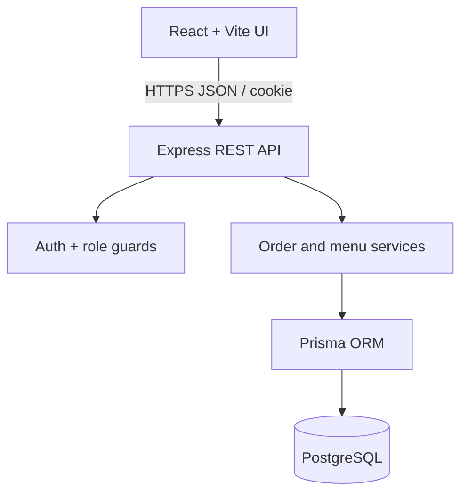
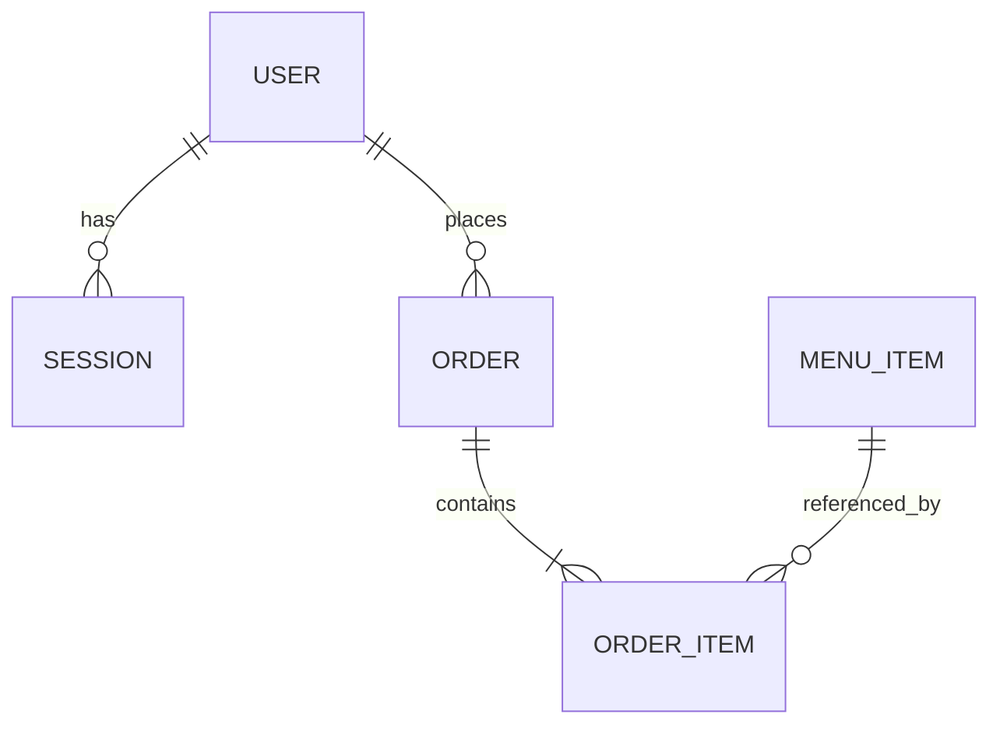

# CampusBite — System-Level Software Design Specification (SDS)

| Field | Value |
|---|---|
| Version | SDS v0.1 (7 November 2026); Lab 7 v0.2 revised 25 November 2026; Deliverable 2 v0.3 revised 26 November 2026 |
| Prepared | 7 November 2026; revised 25 November 2026 (Lab 7 Part A, Issue #48) and 26 November 2026 (Deliverable 2) |
| Source requirements | `docs/srs.md` |
| Assessment | Deliverable 1, Part C (15 points); Deliverable 2, Sprint 2 baseline |

### Team development environments

- **67070503481 (`LaeLaeKaungNyunt`):** Google Antigravity IDE.
- **67070503484 (`naingzaylinn`):** Visual Studio Code.
- Both use separate local clones of the **same** GitHub repository, the same Node/TypeScript/PostgreSQL project conventions, and feature branches from sprint staging. The IDE choice does not change the runtime architecture or required test commands.

## 1. Architecture and technology

CampusBite is a modular monolith with three logical layers. The browser calls a versioned REST API; the API authenticates the request, enforces role/ownership checks and business rules, and changes a PostgreSQL database using Prisma. No business authorization relies on hidden UI controls or a client-supplied role.

| Layer | Choice and responsibility | Reason |
|---|---|---|
| UI | React, TypeScript, Vite | Small customer/operator screens, form validation, state and error feedback. |
| API/application | Node.js, Express, TypeScript | Familiar REST-style API suitable for Supertest and course engineering workflow. |
| Database | PostgreSQL with Prisma and migrations | Transactions, constraints, durable relations, repeatable local/cloud configuration. |
| Tests | Vitest as the test runner, Supertest for Express API requests, and Playwright for selected browser end-to-end tests | Cover rules, real persistence, permissions, and a critical UI journey. |
| Deployment plan | One Docker image on GCP Cloud Run serving built frontend + API; Cloud SQL PostgreSQL | Single origin simplifies cookies and deployment; durable database is external to the container. Lab 5 establishes actual resources. |

The team may substitute an equivalent familiar lab technology **only through an approved SDS revision before implementation**; do not mix stacks informally.

## 2. Major data model

| Entity | Important fields (proposed types) | Constraints / ownership |
|---|---|---|
| `User` | `id` UUID PK, `email` text, `passwordHash` text, `role` enum (`CUSTOMER`,`OPERATOR`), `createdAt` | Unique normalized email; no stored plaintext password; customer order ownership via `id`. |
| `Session` | `id` UUID PK, `userId` FK, `tokenHash` text, `expiresAt`, `createdAt` | Unique token hash; delete on logout; reject expired session; user FK cascade on test-data cleanup. |
| `MenuItem` | `id` UUID PK, `name` text, `description` text?, `priceSatang` integer, `stockQuantity` integer, `isActive` boolean, `createdAt`, `updatedAt` | `priceSatang >= 0`; `stockQuantity >= 0`; inactive items hidden, zero-stock items shown sold out. |
| `Order` | `id` UUID PK, `customerId` FK, `status` enum, `paymentStatus` enum, `totalSatang` integer, `estimatedReadyAt` DateTime? (Lab 7 v0.2), `createdAt`, `updatedAt` | Customer FK, nonnegative total, indexed `(customerId,createdAt)`; initially `PENDING` and `UNPAID`; `estimatedReadyAt` is nullable UTC timestamp calculated at operator acceptance (null for historical orders). |
| `OrderItem` | `id` UUID PK, `orderId` FK, `menuItemId` FK, `quantity` integer, `unitPriceSatang` integer, `lineTotalSatang` integer | Positive quantity; nonnegative prices; unique `(orderId,menuItemId)`; price snapshot remains unchanged after menu edits. |

Reuse the existing PostgreSQL price and stock checks, unique and foreign-key constraints, integer columns, order and payment enums, and nullable Lab 7 ready estimate. The Sprint 2 contracts require no database migration or backfill. The F-05 create handler explicitly writes `isActive: false`. The existing Prisma default still applies to other creation paths such as seeds. Deactivation retains the menu row and its order references.

### Checkout, stock adjustments, and cancellation

1. **Checkout (F-03 with F-05 integration).** Authenticate the Customer and validate a nonempty order with unique menu item IDs and positive integer quantities. In one transaction, lock the menu rows in stable ID order (or use an equivalent concurrency guarantee), recheck activation and availability, and conditionally decrement available stock. Read database unit prices from the same row versions used for reservation. Compute line totals and the order total in integer satang, rejecting values above 2,147,483,647 with `400 INVALID_ORDER`. Save the order and price snapshots in the same transaction. Missing, inactive, or insufficient stock returns `409 OUT_OF_STOCK`. Any failure rolls back every reservation and order write.
2. **Operator stock adjustment (F-05).** `MenuItem.stockQuantity` is available stock after reservations. In one transaction under the menu row lock, compare the stored stock with `expectedStockQuantity`, check headroom, and write the absolute target. The target plus the sum of committed `PENDING` order-line quantities for that item must fit in a PostgreSQL integer. A stale expectation returns `409 STOCK_CHANGED` and insufficient headroom returns `409 STOCK_LIMIT_EXCEEDED`. The same rule applies to inactive items. Metadata edits write only supplied fields so concurrent stock changes survive.
3. **Cancellation (F-06).** Conditionally update the target order from `PENDING` to `CANCELLED`, with owner scope in the Customer write predicate or an equivalent check within the transaction. Only the winner increments stock, using the saved quantity of each order line even if the menu item is inactive. Use atomic increments and acquire menu locks in the same stable ID order as checkout. Commit the order state and all increments together. A failed stock write rolls back the entire cancellation. Order lines, price snapshots, totals, payment status, ownership, and the ready estimate are preserved.

Compute the headroom sum after acquiring the menu lock using a fresh committed read of pending lines without locking the orders in that read. An uncommitted cancellation still counts toward headroom until its stock increments and status commit together. Checkout holds the relevant locks through order creation, so an adjustment sees either the unreserved stock before checkout or the matching reservation after commit. Acceptance removes a reservation from the pending sum without changing available stock. F-04 acceptance and F-06 cancellation both require `PENDING` so only one can win.

### Order and payment states

- **Sprint 1 / Lab 7 (F-04).** An Operator accepts `PENDING → ACCEPTED` with `estimatedPrepMinutes` as an integer multiple of 5 from 5 through 60. The server atomically records `ACCEPTED` and calculates `estimatedReadyAt` in UTC. Invalid estimates return `400 INVALID_PREP_ESTIMATE` and repeat acceptance returns `409 ORDER_NOT_PENDING`.
- **Sprint 2 cancellation (F-06).** `PENDING → CANCELLED` is available to the Customer owner or an Operator. `CANCELLED` is terminal. Later or repeat requests return `409 ORDER_NOT_PENDING` for an accessible order.
- **Sprint 2 fulfillment (F-07).** An Operator can perform only `ACCEPTED → PREPARING → READY → COMPLETED`, one step at a time. The API conditionally matches the expected predecessor and writes only status and the managed `updatedAt`. A known enum target that is skipped, backward, repeated, or otherwise disallowed returns `409 ORDER_NOT_PENDING`. Fulfillment preserves the stored estimate, including historical nulls. Time passage never advances the order.
- **Sprint 2 payment (F-08).** An Operator can mark an `UNPAID` order as `PAID_SIMULATED` only in `ACCEPTED`, `PREPARING`, `READY`, or `COMPLETED`. The conditional write checks the order ID, unpaid state, and eligible fulfillment state together and changes only payment status and the managed `updatedAt`. Unpaid pending or cancelled orders return `409 PAYMENT_ORDER_INELIGIBLE`. Already-paid orders return `409 PAYMENT_ALREADY_RECORDED`. Payment is one-way, uses the existing order field, and involves zero provider calls or financial inputs. Payment and fulfillment update their own fields, so concurrent eligible operations preserve both results. Completion is valid while unpaid.
- **Sprint 3 reporting (F-09, BR-13).** Count only orders with both saved states `COMPLETED` and `PAID_SIMULATED`, using stored order-item prices. Cancelled orders are excluded.

## 3. UI structure and conventions

| Route / screen | Role | Behavior |
|---|---|---|
| `/login` | Visitor | Email/password form; validation; generic invalid-login error. |
| `/menu` | Customer (menu may also be browsed anonymously) | Active menu, THB prices, stock badges, add-to-cart controls; inactive hidden. |
| `/cart` | Customer | Quantity editing, provisional displayed total, submit; server response is authoritative. |
| `/orders` | Customer | Show own orders newest first and retrieve persisted status on load or refresh. Offer Cancel for pending orders and reconcile the list after a server-confirmed cancellation. |
| `/orders/:id` | Owning Customer | Show saved items, price snapshots, total, current status, and read-only simulated payment state. Offer Cancel for pending orders. Display a non-null `estimatedReadyAt` only during `ACCEPTED` and `PREPARING`. The API still returns the stored value after readiness and completion. |
| `/operator/orders` | Operator | Show café orders. For pending orders offer cancellation or acceptance with the Lab 7 estimate selector. For accepted, preparing, or ready orders offer the next legal fulfillment action. Show **Unpaid** or **Paid (simulated)** and offer **Mark paid (simulated)** only for eligible unpaid orders. |
| `/operator/menu` | Operator | List active and inactive items. Create inactive items and edit metadata, activation, or availability. Display THB prices and convert decimal digits to integer satang. On a stale stock conflict reload the saved quantity and require review before resubmission. Use server responses as the saved state and retain drafts on validation or network failure. |
| Later screens | Operator/Customer | Sprint 3 order filtering and operator reporting. |

Sprint 2 order actions disable the relevant control while submitting, display the saved response, and surface safe errors. Reconcile with server state after a conflict. Customer status uses the existing reads on load or manual refresh.

UI conventions: clear loading/empty/error states; nonblocking form feedback; disable an action during pending submission; show server validation messages safely; never use UI visibility as a replacement for API permission enforcement. The frontend does not send an authoritative user ID, role, unit price, or trusted total when creating orders.

## 4. API approach and conventions

Prefix all application endpoints with `/api/v1`. Successful responses return JSON objects; list endpoints return arrays in a named `data` property. Errors use an object such as `{ "error": { "code": "OUT_OF_STOCK", "message": "Item is unavailable" } }`, with no stack traces or password/session secrets.

| Method and path | Role | Purpose / key response |
|---|---|---|
| `POST /api/v1/auth/login` | Public | Accept email/password; create session cookie; return safe user identity. |
| `POST /api/v1/auth/logout` | Authenticated | Revoke current server-side session and clear cookie. |
| `GET /api/v1/auth/me` | Authenticated | Return authenticated user's ID, email and role. |
| `GET /api/v1/menu-items` | Public | Active menu entries, THB price in satang, availability/stock status. |
| `POST /api/v1/orders` | Customer | Accept `{ items: [{ menuItemId, quantity }] }`; return persisted ID, items, total and status. |
| `GET /api/v1/orders` | Customer | Return only own orders. |
| `GET /api/v1/orders/:id` | Owning Customer | Return saved order; another customer's order responds as not found. Returns `estimatedReadyAt: string \| null`. |
| `GET /api/v1/operator/orders` | Operator | Return café orders, including `estimatedReadyAt: string \| null`, optionally filtered by status later. |
| `PATCH /api/v1/operator/orders/:id/accept` | Operator | Accept pending order with `{"estimatedPrepMinutes": 5..60}`; server calculates and atomically persists `estimatedReadyAt`; returns 200 with new status and estimate. |

### Planned Sprint 2 endpoints

| Method and path | Access | Request and persisted result |
|---|---|---|
| `GET /api/v1/operator/menu-items` | Operator | Return all catalog rows sorted by name then ID. |
| `POST /api/v1/operator/menu-items` | Operator | Require name, `priceSatang`, and `stockQuantity`. Accept an optional description. Return the inactive item with `201`. |
| `PATCH /api/v1/operator/menu-items/:id` | Operator | Allow a nonempty subset of name, description, `priceSatang`, and `isActive`. Return the saved item. |
| `PATCH /api/v1/operator/menu-items/:id/stock` | Operator | Require exactly `stockQuantity` and `expectedStockQuantity`. Return the saved item after the stock checks. |
| `PATCH /api/v1/orders/:id/cancel` | Customer owner | No body required. Return saved `id`, `status`, and `updatedAt`. |
| `PATCH /api/v1/operator/orders/:id/cancel` | Operator | Same cancellation result for any café order. |
| `PATCH /api/v1/operator/orders/:id/status` | Operator | Accept exactly one `status` field with a recognized uppercase enum value. Return saved `id`, `status`, nullable `estimatedReadyAt`, and `updatedAt`. |
| `PATCH /api/v1/operator/orders/:id/payment` | Operator | Accept exactly `{"paymentStatus":"PAID_SIMULATED"}`. Return saved `id`, `paymentStatus`, and `updatedAt`. |

Use the existing Express operator router and session/role guard for operator endpoints, and the customer order router and owner-scoped reads for Customer endpoints. Public menu reads stay active-only and compute availability from positive stock. Existing order reads carry the saved fulfillment status, simulated payment state, and ready estimate within their respective role and ownership scope.

Menu inputs use the contract's field validation and reject numeric values above the PostgreSQL integer maximum. Invalid menu, fulfillment, and payment payloads use their feature-specific `400` errors. Malformed IDs on Operator routes return `400 BAD_REQUEST`. Customer cancellation uses `404 ORDER_NOT_FOUND` for malformed IDs, absent records, and records belonging to another Customer. Resolve identity from the server session and enforce the role before entering protected workflows. A cancellation payload cannot authorize an order or specify which quantities to restore.

Standard status policy: `200` successful read/update, `201` created order, `400` invalid shape/quantity or invalid prep estimate (`INVALID_PREP_ESTIMATE`), `401` no/invalid session, `403` authenticated wrong role, `404` absent or unauthorized private resource, `409` unavailable stock or invalid transition (`ORDER_NOT_PENDING`), `500` sanitized internal error. Full request/response examples and boundaries are specified in feature contracts.

## 5. Roles and ownership matrix

| Operation | Guest | Customer | Operator |
|---|---|---|---|
| Browse published menu | Yes | Yes | Yes |
| Login | Yes | Yes | Yes |
| Current identity / logout | No | Own session | Own session |
| Create order | No | Yes | No (no customer impersonation) |
| View order detail & ready estimate | No | Own only | Through operator order view |
| List all café orders | No | No | Yes |
| Accept pending order with estimate | No | No | Yes |
| Edit menu/stock (Sprint 2) | No | No | Yes |
| Cancel pending order (Sprint 2) | No | Own only | Authorized café orders |
| Advance fulfillment (Sprint 2) | No | No | Next legal transition |
| Record simulated payment (Sprint 2) | No | No | Eligible unpaid café orders |
| Sales summary (Sprint 3) | No | No | Yes |

Backend middleware identifies the session and role. Order queries scope customer results by `customerId` regardless of the ID appearing in the URL. Never accept `role` or `customerId` from request JSON as authority.

## 6. Authentication/session lifecycle

**Proposed decision for team approval before code:** An opaque, cryptographically random session token is issued after valid login in an `HttpOnly`, `SameSite=Lax` cookie. Only a hash of that token is stored in the `Session` table. Sessions expire after 24 hours and are deleted on logout. The cookie uses `Secure` under HTTPS (GCP). The `/auth/me` endpoint resolves the user from the server-side session; the client cannot select a role. Rate limiting and origin/CSRF protection for state-changing cookie-authenticated requests are planned before public deployment.

Seeded accounts are sufficient. Test invalid login, anonymous access, wrong role, other-user access and logout. Credentials for local demos are synthetic and supplied through seed/controlled course handoff, not real production passwords or hard-coded client secrets.

## 7. Configuration, setup and deployment design

Planned configuration variables: `DATABASE_URL`, `PORT`, `NODE_ENV`, `FRONTEND_ORIGIN`, and `COOKIE_SECURE` (or equivalent documented settings). Commit a safe `.env.example`, **never** real `.env` files, access tokens or production secrets. Local setup must document Node/package-manager version, PostgreSQL setup, Prisma migrations, seed command, start/build/test commands and safe account handoff.

For Lab 5, package the accepted application with Docker and deploy the combined frontend/API to GCP Cloud Run using a persistent PostgreSQL service such as Cloud SQL. The container filesystem is not the persistent database. A reviewed release from `main` will be delivered via CI/CD; cloud resources are not needed for Deliverable 1.

## 8. Verification architecture

- **Unit:** Vitest as the test runner for validation, money calculation, and allowed state transitions.
- **API/database integration:** Supertest for Express API requests, verifying real PostgreSQL transactions, persistence, role/owner enforcement, boundary/negative cases, and competing stock requests.
- **Selected UI/end-to-end:** Playwright for selected browser end-to-end tests (Customer login → menu → order → persisted details, Operator login → acceptance, plus a rejected case).
- **Build/reproduction:** record commands, pass/fail/skip totals, tested commit SHA, setup instructions and screenshots in Deliverable 1 Part F.
- **TDD evidence:** retain a meaningful rule test failing before behavior implementation and passing afterward; preserve specification/test/code chronology in Git.

## 9. Design status and review

This is the system-level design for CampusBite. The baseline was established in Sprint 1 v0.1 (7 November 2026) and revised in Lab 7 v0.2 (25 November 2026, Issue #48) to integrate operator preparation time estimation and atomic estimated ready time persistence. All design adjustments are reflected across SRS (`srs.md`), F-04 contract (`f04-operator.md`), test specification (`test-specification.md`), and traceability (`traceability.md`). Lab 7 Part A documentation changes are recorded as Designed / Not run; no cloud, CI or schema execution is claimed at this stage.

Deliverable 2 v0.3 (26 November 2026) records the reviewed Sprint 2 design from PR #52 and PR #53. Implementation awaits verification and all new cases are **Designed / Not run**. See the [feature contracts](sprints/sprint-2/) and [requirements-to-test mappings](traceability.md).
