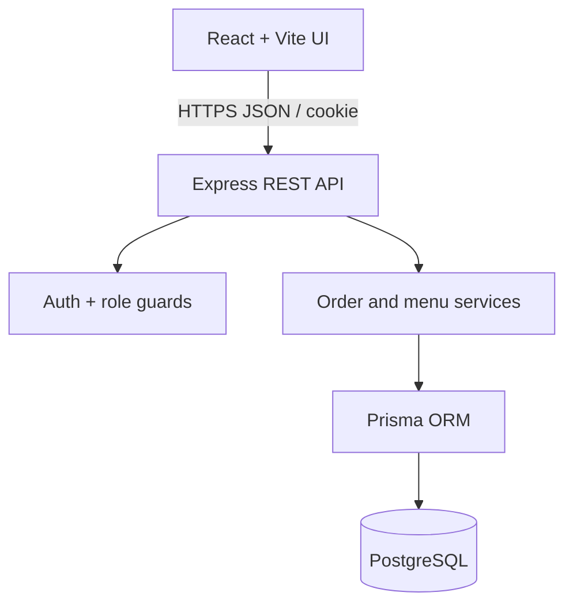
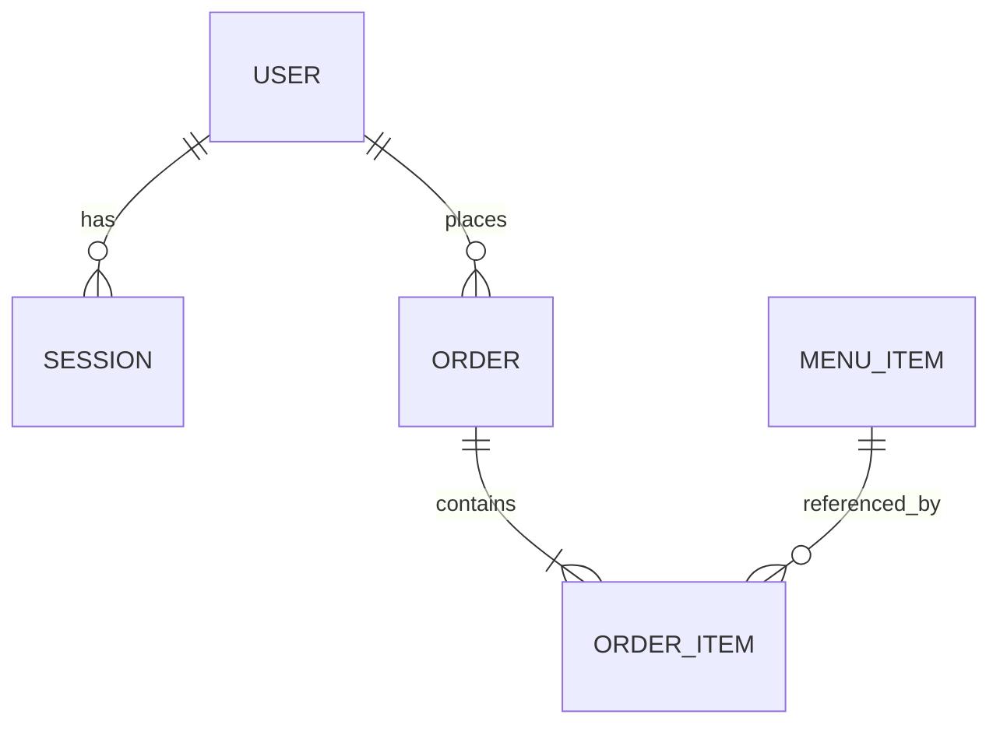

# CampusBite — System-Level Software Design Specification (SDS)

| Field | Value |
|---|---|
| Version | SDS v0.1, proposed for team review |
| Prepared | 7 November 2026 |
| Source requirements | `docs/srs.md` |
| Assessment | Deliverable 1, Part C (15 points) |

### Team development environments

- **67070503481 (`LaeLaeKaungNyunt`):** Google Antigravity IDE.
- **67070503484 (`naingzaylinn`):** Visual Studio Code.
- Both use separate local clones of the **same** GitHub repository, the same Node/TypeScript/PostgreSQL project conventions, and feature branches from sprint staging. The IDE choice does not change the runtime architecture or required test commands.

## 1. Architecture and technology

CampusBite is a modular monolith with three logical layers. The browser calls a versioned REST API; the API authenticates the request, enforces role/ownership checks and business rules, and changes a PostgreSQL database using Prisma. No business authorization relies on hidden UI controls or a client-supplied role.

| Layer | Choice and responsibility | Reason |
|---|---|---|
| UI | React, TypeScript, Vite | Small customer/operator screens, form validation, state and error feedback. |
| API/application | Node.js, Express, TypeScript | Familiar REST-style API suitable for Supertest and course engineering workflow. |
| Database | PostgreSQL with Prisma and migrations | Transactions, constraints, durable relations, repeatable local/cloud configuration. |
| Tests | Unit test runner (Vitest or existing lab runner), Supertest API/database tests, selected Playwright browser tests | Cover rules, real persistence, permissions, and a critical UI journey. Final runner choice follows project bootstrap. |
| Deployment plan | One Docker image on GCP Cloud Run serving built frontend + API; Cloud SQL PostgreSQL | Single origin simplifies cookies and deployment; durable database is external to the container. Lab 5 establishes actual resources. |

The team may substitute an equivalent familiar lab technology **only through an approved SDS revision before implementation**; do not mix stacks informally.

## 2. Major data model

| Entity | Important fields (proposed types) | Constraints / ownership |
|---|---|---|
| `User` | `id` UUID PK, `email` text, `passwordHash` text, `role` enum (`CUSTOMER`,`OPERATOR`), `createdAt` | Unique normalized email; no stored plaintext password; customer order ownership via `id`. |
| `Session` | `id` UUID PK, `userId` FK, `tokenHash` text, `expiresAt`, `createdAt` | Unique token hash; delete on logout; reject expired session; user FK cascade on test-data cleanup. |
| `MenuItem` | `id` UUID PK, `name` text, `description` text?, `priceSatang` integer, `stockQuantity` integer, `isActive` boolean, `createdAt`, `updatedAt` | `priceSatang >= 0`; `stockQuantity >= 0`; inactive items hidden, zero-stock items shown sold out. |
| `Order` | `id` UUID PK, `customerId` FK, `status` enum, `paymentStatus` enum, `totalSatang` integer, `createdAt`, `updatedAt` | Customer FK, nonnegative total, indexed `(customerId,createdAt)`; initially `PENDING` and `UNPAID`. |
| `OrderItem` | `id` UUID PK, `orderId` FK, `menuItemId` FK, `quantity` integer, `unitPriceSatang` integer, `lineTotalSatang` integer | Positive quantity; nonnegative prices; unique `(orderId,menuItemId)`; price snapshot remains unchanged after menu edits. |

PostgreSQL checks and unique/FK constraints will be implemented through migrations, not solely application-level validation. The complete schema in `backend/prisma/schema.prisma` and any SQL migration checks must match this model.

### Stock and order transaction

1. Authenticate the Customer; validate a nonempty list, unique item IDs and positive integer quantities.
2. Begin a database transaction. For each item, load its current active status/price and conditionally decrement stock only if enough stock remains.
3. If any item is absent, inactive, or insufficiently stocked, roll back **every** decrement and do not create an order.
4. Calculate line totals using integer satang and create the order/order items with unit-price snapshots.
5. Commit the transaction; return the new order ID and authoritative total.

Conditional updates and/or serializable retry handling must prevent competing requests from both reserving the final units. Test both a normal failure and a competing-request boundary case.

### State model

- Sprint 1: `PENDING → ACCEPTED` (Operator only). Invalid/repeated acceptance returns a conflict and leaves the record unchanged.
- Sprint 2: `PENDING → CANCELLED` (with exactly-once stock restore) and `ACCEPTED → PREPARING → READY → COMPLETED`.
- Payment status is separate: `UNPAID → PAID_SIMULATED` by an Operator. No real gateway is connected.

## 3. UI structure and conventions

| Route / screen | Role | Behavior |
|---|---|---|
| `/login` | Visitor | Email/password form; validation; generic invalid-login error. |
| `/menu` | Customer (menu may also be browsed anonymously) | Active menu, THB prices, stock badges, add-to-cart controls; inactive hidden. |
| `/cart` | Customer | Quantity editing, provisional displayed total, submit; server response is authoritative. |
| `/orders` | Customer | Own orders, newest first, empty state. |
| `/orders/:id` | Owning Customer | Persisted items, price snapshots, total, status; never show another owner's data. |
| `/operator/orders` | Operator | Incoming orders, detail and Accept action for `PENDING` only. |
| Later screens | Operator/Customer | Menu administration, cancellation, fulfillment, payment and reporting as allocated in the sprint plan. |

UI conventions: clear loading/empty/error states; nonblocking form feedback; disable an action during pending submission; show server validation messages safely; never use UI visibility as a replacement for API permission enforcement. The frontend does not send an authoritative user ID, role, unit price, or trusted total when creating orders.

## 4. API approach and conventions

Prefix all application endpoints with `/api/v1`. Successful responses return JSON objects; list endpoints return arrays in a named `data` property. Errors use an object such as `{ "error": { "code": "OUT_OF_STOCK", "message": "Item is unavailable" } }`, with no stack traces or password/session secrets.

| Method and path | Role | Purpose / key response |
|---|---|---|
| `POST /api/v1/auth/login` | Public | Accept email/password; create session cookie; return safe user identity. |
| `POST /api/v1/auth/logout` | Authenticated | Revoke current server-side session and clear cookie. |
| `GET /api/v1/auth/me` | Authenticated | Return authenticated user's ID, email and role. |
| `GET /api/v1/menu-items` | Public | Active menu entries, THB price in satang, availability/stock status. |
| `POST /api/v1/orders` | Customer | Accept `{ items: [{ menuItemId, quantity }] }`; return persisted ID, items, total and status. |
| `GET /api/v1/orders` | Customer | Return only own orders. |
| `GET /api/v1/orders/:id` | Owning Customer | Return saved order; another customer's order responds as not found. |
| `GET /api/v1/operator/orders` | Operator | Return café orders, optionally filtered by status later. |
| `PATCH /api/v1/operator/orders/:id/accept` | Operator | Accept only pending order; return persisted new status. |

Standard status policy: `200` successful read/update, `201` created order, `400` invalid shape/quantity, `401` no/invalid session, `403` authenticated wrong role, `404` absent or unauthorized private resource, `409` unavailable stock or invalid transition, `500` sanitized internal error. Full request/response examples and boundaries are specified in feature contracts.

## 5. Roles and ownership matrix

| Operation | Guest | Customer | Operator |
|---|---|---|---|
| Browse published menu | Yes | Yes | Yes |
| Login | Yes | Yes | Yes |
| Current identity / logout | No | Own session | Own session |
| Create order | No | Yes | No (no customer impersonation) |
| View order detail | No | Own only | Through operator order view |
| List all café orders | No | No | Yes |
| Accept pending order | No | No | Yes |
| Edit menu/stock (Sprint 2) | No | No | Yes |
| Cancel pending order (Sprint 2) | No | Own only | Authorized café orders |
| Change fulfillment/payment (Sprint 2) | No | No | Yes |
| Sales summary (Sprint 3) | No | No | Yes |

Backend middleware identifies the session and role. Order queries scope customer results by `customerId` regardless of the ID appearing in the URL. Never accept `role` or `customerId` from request JSON as authority.

## 6. Authentication/session lifecycle

**Proposed decision for team approval before code:** An opaque, cryptographically random session token is issued after valid login in an `HttpOnly`, `SameSite=Lax` cookie. Only a hash of that token is stored in the `Session` table. Sessions expire after 24 hours and are deleted on logout. The cookie uses `Secure` under HTTPS (GCP). The `/auth/me` endpoint resolves the user from the server-side session; the client cannot select a role. Rate limiting and origin/CSRF protection for state-changing cookie-authenticated requests are planned before public deployment.

Seeded accounts are sufficient. Test invalid login, anonymous access, wrong role, other-user access and logout. Credentials for local demos are synthetic and supplied through seed/controlled course handoff, not real production passwords or hard-coded client secrets.

## 7. Configuration, setup and deployment design

Planned configuration variables: `DATABASE_URL`, `PORT`, `NODE_ENV`, `FRONTEND_ORIGIN`, and `COOKIE_SECURE` (or equivalent documented settings). Commit a safe `.env.example`, **never** real `.env` files, access tokens or production secrets. Local setup must document Node/package-manager version, PostgreSQL setup, Prisma migrations, seed command, start/build/test commands and safe account handoff.

For Lab 5, package the accepted application with Docker and deploy the combined frontend/API to GCP Cloud Run using a persistent PostgreSQL service such as Cloud SQL. The container filesystem is not the persistent database. A reviewed release from `main` will be delivered via CI/CD; cloud resources are not needed for Deliverable 1.

## 8. Verification architecture

- **Unit:** validation, money calculation, allowed state transitions.
- **API/database integration:** real PostgreSQL transaction, persistence, role/owner enforcement, boundary/negative cases, competing stock requests.
- **Selected UI/end-to-end:** Customer login → menu → order → persisted details, Operator login → acceptance, plus a rejected case.
- **Build/reproduction:** record commands, pass/fail/skip totals, tested commit SHA, setup instructions and screenshots in Deliverable 1 Part F.
- **TDD evidence:** retain a meaningful rule test failing before behavior implementation and passing afterward; preserve specification/test/code chronology in Git.

## 9. Design status and review

This is the **proposed** system-level design, not a claim of implemented behavior. Both students must review it, especially the transaction strategy, auth/session approach, and test runner, before approving the documentation PR. Any changes must be reflected in SRS, feature contracts, traceability and implementation/tests. No cloud or CI execution is claimed at this stage.

